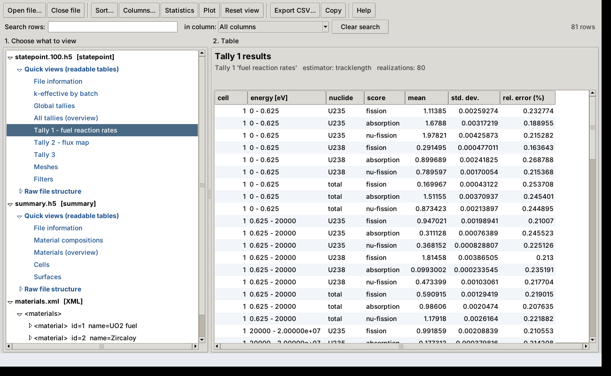

# OpenMC Output Viewer

A simple desktop app for Ubuntu Linux that opens any **OpenMC** output file
(`.h5` and `.xml`) and shows its contents as clear, sortable tables.

**Only Python is needed.** No `h5py`, `numpy`, `pandas` or `openmc`: the app has
its own HDF5 reader written in pure Python, and the window uses `tkinter`,
which comes with Python.



## Install and run (Ubuntu)

```bash
sudo apt install python3 python3-tk git
```

```bash
git clone https://github.com/ElieMweze/openmc-output-viewer.git
```

```bash
cd openmc-output-viewer && python3 openmc_viewer.py
```

You can also open files directly:

```bash
python3 openmc_viewer.py statepoint.100.h5 summary.h5
```

To add the app to the Ubuntu applications menu:

```bash
bash install.sh
```

> `python3-tk` is part of Python but Ubuntu installs it separately.
> Python 3.8 or newer works (Ubuntu 20.04, 22.04, 24.04).

## How to use it

1. Click **Open file...** and choose an OpenMC file. You can open several files.
2. In the left panel:
   * **Quick views** are ready-made, readable tables.
   * **Raw file structure** shows everything stored in the file
     (folders = HDF5 groups, data = datasets).
3. Click an item to show it as a table on the right.
4. Organize the table:

| Button / action | What it does |
|---|---|
| Click a **column title** | Sort by that column (click again to reverse, a third time to undo) |
| **Sort...** | Choose a column and the order (smallest or largest first) |
| **Search rows** | Keep only the rows containing a word or number. Pick a column and type `>0.5`, `<=1e-3`, `=92` or `!=0` to filter numbers |
| **Columns...** | Hide or show columns |
| **Statistics** | Count, min, max, average, standard deviation and sum of numeric columns |
| **Plot** | Quick graph of a column, with error bars from the standard deviation |
| **Reset view** | Undo sorting, search and hidden columns |
| **Export CSV...** | Save the table for LibreOffice Calc or Excel (full precision) |
| **Copy** | Copy the table to the clipboard (paste into a spreadsheet) |
| **Combine sub-folders into one table** | For a group such as `materials` or `geometry/cells`: one row per sub-group |

## Quick views for OpenMC files

| File | Quick views |
|---|---|
| `statepoint.*.h5` | File information, k-effective by batch (with Shannon entropy), global tallies, overview of all tallies, **each tally's results** (one row per filter bin × nuclide × score with mean, standard deviation and relative error), meshes, filters |
| `summary.h5` | Material compositions (nuclide densities), materials, cells, surfaces, universes, lattices, nuclides |
| `depletion_results.h5` | k-effective vs time |
| any other `.h5` | The full structure, and every dataset as a table |
| `.xml` (`materials.xml`, `tallies.xml`, `settings.xml`, ...) | Tree of elements. Selecting an element shows its child elements as table rows and their attributes as columns |

Tally statistics follow OpenMC's formulas:
`mean = sum / n` and `std. dev. = sqrt((sum_sq / n - mean²) / (n - 1))`,
where `n` is the number of realizations (active batches).

## Supported HDF5 features

The built-in reader (`openmc_viewer/hdf5.py`) supports what OpenMC and h5py write:
old and new file formats, groups of any size, attributes,
contiguous/compact/chunked datasets, gzip + shuffle + fletcher32 compression,
and integer, float, string, compound, enum/bool and array data types.
Datasets that use other compression filters (szip, lzf, blosc, zstd) cannot be read.

## Examples and tests

The `examples/` folder has small OpenMC-style files for trying the app.
Run the tests (standard library only):

```bash
python3 -m unittest discover tests
```

`tests/make_examples.py` regenerates the example files. It is a developer tool
and needs `h5py` and `numpy`; the viewer itself does not.

## Author

elie mweze biayi. MIT License.
